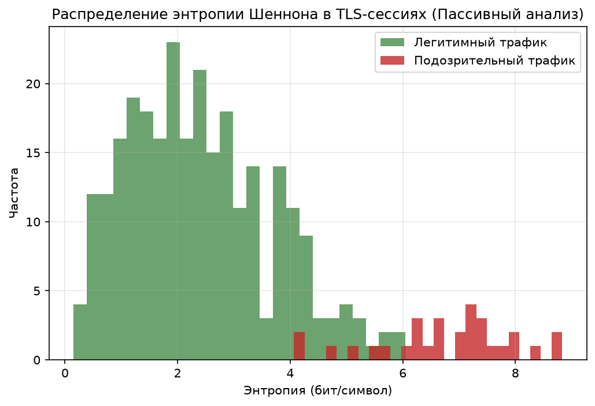

# Динамическое включение веб-ресурсов в «белые списки»

Данный сайт публикует результаты научно-исследовательской работы по разработке метода пассивного анализа TLS-трафика и ML-скоринга для автоматизированной верификации ресурсов.

## Математическая модель скоринга

Для оценки благонадежности ресурса на уровне граничных коммутаторов используется расчет энтропии Шеннона первых $N$ пакетов сессии:

$$ H(X) = -\sum_{i=1}^{n} p(x_i) \log_2 p(x_i) $$

Где $p(x_i)$ — вероятность встречи $i$-го символа в заголовке TLS-пакета. Высокая энтропия указывает на шифрованный или сжатый трафик, что является базовым признаком для дальнейшего ML-анализа.

## Результаты воспроизводимого конвейера (P3)

Ниже представлены артефакты, которые **автоматически генерируются** скриптом сборки при каждом обновлении данных:

### Распределение энтропии TLS-пакетов

### Итоговые метрики модели


---
*Дата последней сборки сайта и хеш коммита указаны в таблице выше.*