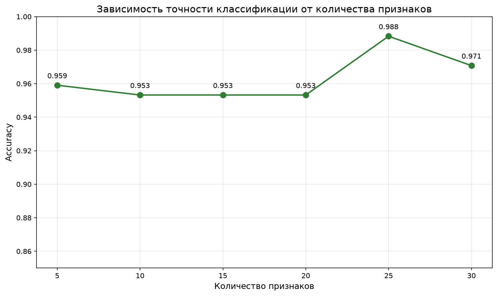
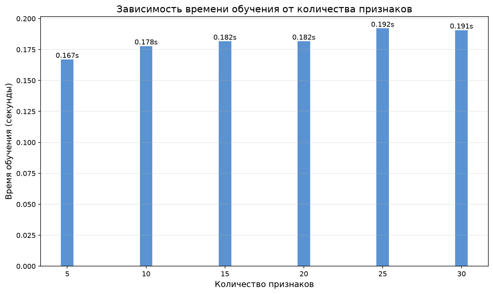

# НИР: Динамическое включение в белые списки

## Эксперимент: Влияние количества признаков на точность ML

В рамках исследования проведён эксперимент по оценке влияния количества признаков на качество классификации (как прокси для анализа TLS-трафика).

### Методика

- **Датасет:** breast_cancer (569 образцов, 30 признаков) — используется как аналог признаков TLS-сессий
- **Модель:** Random Forest (100 деревьев)
- **Разделение:** 70% train, 30% test
- **Метрики:** Accuracy, F1-Score, время обучения
- **Варианты:** 5, 10, 15, 20, 25, 30 признаков

### Результаты



---

*Эксперимент автоматически воспроизводится при каждой сборке сайта через Makefile*